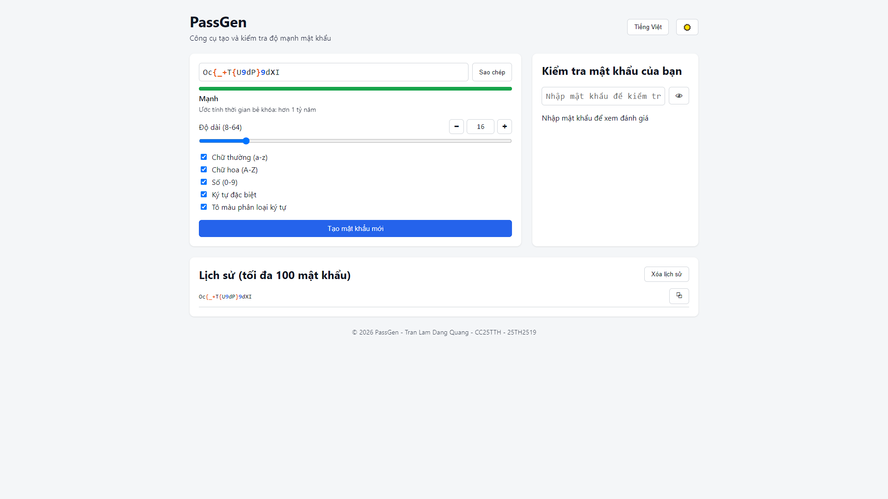

# PassGen
PassGen là công cụ web giúp tạo mật khẩu ngẫu nhiên  và kiểm tra độ mạnh của mật khẩu. Toàn bộ xử lý diễn ra trên trình duyệt, mật khẩu không được gửi lên bất kỳ máy chủ nào.

Giao diện PassGen

## Tính năng

- Tạo mật khẩu ngẫu nhiên với độ dài 8–64 ký tự (thanh trượt, ô số, nút + / −)
- Chọn loại ký tự: chữ thường, chữ hoa, số, ký tự đặc biệt
- Tô màu phân loại ký tự: số màu xanh, ký tự đặc biệt màu cam (có thể tắt)
- Thanh đo độ mạnh và ước tính thời gian bẻ khóa
- Kiểm tra mật khẩu của bạn, có nút hiện/ẩn và gợi ý cải thiện
- Lịch sử mật khẩu trong phiên (tối đa 100 mật khẩu), có nút sao chép từng cái và nút xóa
- Giao diện tiếng Việt và tiếng Anh
- Chế độ sáng/tối, tự nhớ lựa chọn

## Demo

Bản chạy trực tiếp: https://<tên-github>.github.io/passgen/

## Chạy trên máy

Dự án không cần cài đặt thư viện hay công cụ build.

1. Tải mã nguồn:
    bash
    git clone https://github.com/quangtldcc25tth-cell/passgen.git
    cd passgen
   
2. Mở file `index.html` bằng trình duyệt.

Hoặc dùng extension Live Server trong VS Code: nhấp chuột phải `index.html` → Open with Live Server.

## Cách hoạt động

- Sinh mật khẩu: dùng `crypto.getRandomValues` (bộ sinh số ngẫu nhiên an toàn của trình duyệt), không dùng `Math.random`. Các số ngẫu nhiên được lấy mẫu không lệch (rejection sampling), nên mọi ký tự có xác suất như nhau.
- Đảm bảo đủ loại ký tự: mỗi loại đã chọn luôn xuất hiện ít nhất một lần, sau đó toàn bộ mảng ký tự được xáo trộn.
- Độ mạnh: tính entropy `độ dài × log₂(kích thước bảng ký tự)`. Mật khẩu chứa mẫu phổ biến (như `123456`, `password`) bị đánh giá rất yếu.
- Ước tính thời gian bẻ khóa: giả định kẻ tấn công thử 10 tỷ mật khẩu mỗi giây (tấn công offline) và mật khẩu được chọn ngẫu nhiên hoàn toàn.

### Giới hạn

- Ước tính thời gian bẻ khóa chỉ mang tính tham khảo. Mật khẩu do người đặt thường dễ đoán hơn.
- Công cụ không kiểm tra mật khẩu có bị rò rỉ hay không.
- Lịch sử chỉ tồn tại trong phiên làm việc, tải lại trang sẽ xóa sạch.

## Cấu trúc thư mục

passgen/
index.html     # Giao diện
style.css      # Kiểu dáng, hỗ trợ chế độ sáng/tối
script.js      # Logic sinh mật khẩu, đánh giá, đa ngôn ngữ
LICENSE        # Giấy phép MIT
README.md

## Đóng góp
Mọi đóng góp đều được hoan nghênh.

## Giấy phép

Dự án được phát hành theo giấy phép [MIT](LICENSE).

Trần Lâm Đăng Quang, lớp CC25TTH, MSSV 25TH2519. môn Phát triển phần mềm mã nguồn mở.